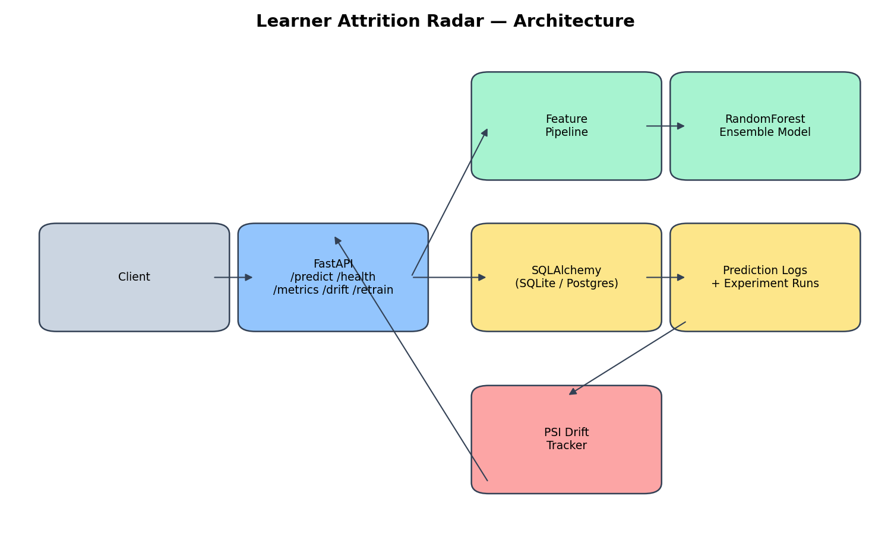

# Learner Attrition Radar

Predicts dropout risk for self-paced online learners from behavioral telemetry — session
cadence, quiz performance, video and assignment completion, forum activity — and tracks
whether that behavior is drifting away from what the model was trained on.

Inspired by the shape of self-paced curricula like [ossu/computer-science](https://github.com/ossu/computer-science):
learners move through material at their own pace with no instructor checking in, which is
exactly the setting where early attrition signals matter most.



## Model — read this before trusting any number below

**The model is trained entirely on synthetic data.** `app/features.py` generates learner
telemetry from parametric distributions with a hand-picked relationship between engagement
and a simulated dropout label — there is no real course platform behind it. Cross-validated
metrics reported by `/retrain` and `scripts/train_model.py` describe how well the model fits
*that synthetic generator*, not real-world learner behavior. Treat this as a demonstration of
the pipeline (features → ensemble model → serving → drift tracking), not a validated
attrition predictor.

## Architecture

- **FastAPI** service with five endpoints: `/predict`, `/health`, `/metrics`, `/drift`, `/retrain`.
- **Feature pipeline** (`app/features.py`) — six behavioral features per learner.
- **RandomForestClassifier** ensemble (`app/ml_model.py`), cross-validated (AUC-ROC, precision,
  recall) on every training run.
- **SQLAlchemy** models (`app/models.py`) for prediction logs and experiment runs — SQLite by
  default, Postgres via `docker-compose --profile postgres`.
- **PSI-based drift tracking** (`app/drift.py`) — compares the feature distribution of recent
  predictions against the training-time baseline.
- **Experiment tracking** (`app/experiment_tracking.py`) — every training/retraining run is
  logged with its hyperparameters and metrics.
- **Automated retraining** — `POST /retrain` re-fits and promotes a new model version in place.

### Bonus items implemented

1. Drift detection via Population Stability Index (PSI).
2. Cross-validation reporting: AUC-ROC, precision, recall on every training run.
3. Experiment tracking (`experiment_runs` table).
4. Automated retraining endpoint (`POST /retrain`).

## Quick start

```bash
python -m venv .venv && source .venv/bin/activate
pip install -r requirements.txt
cp .env.example .env

uvicorn app.main:app --reload
```

The first request trains and persists an initial model automatically if `models/model.joblib`
doesn't exist yet. To train explicitly instead:

```bash
python -m scripts.train_model
```

### Docker

```bash
docker compose up --build
# or, with Postgres instead of SQLite:
docker compose --profile postgres up --build
```

## API

| Method | Path | Description |
|---|---|---|
| `GET` | `/health` | Liveness check, reports the loaded model version. |
| `POST` | `/predict` | Score one learner's telemetry; returns `risk_score`, `risk_label`, `model_version`. |
| `GET` | `/metrics` | Prediction count and the latest experiment run's cross-validated metrics. |
| `GET` | `/drift` | PSI drift report comparing recent predictions to the training baseline. |
| `POST` | `/retrain` | Re-fit the ensemble on freshly generated synthetic data and promote it. |

Example:

```bash
curl -X POST http://localhost:8000/predict \
  -H "Content-Type: application/json" \
  -d '{
    "avg_session_length_minutes": 18.5,
    "days_since_last_login": 3,
    "quiz_avg_score": 74,
    "video_completion_rate": 0.62,
    "forum_posts_count": 2,
    "assignment_submission_rate": 0.8
  }'
```

## Testing

```bash
pytest -q
ruff check .
```

All external state (the trained model, the database) is stubbed or in-memory in tests — no
network calls are made.

## Environment variables

See `.env.example`. `DATABASE_URL` selects SQLite (default) or Postgres; `MODEL_DIR` is where
the trained model bundle and drift baseline are read from and written to.
